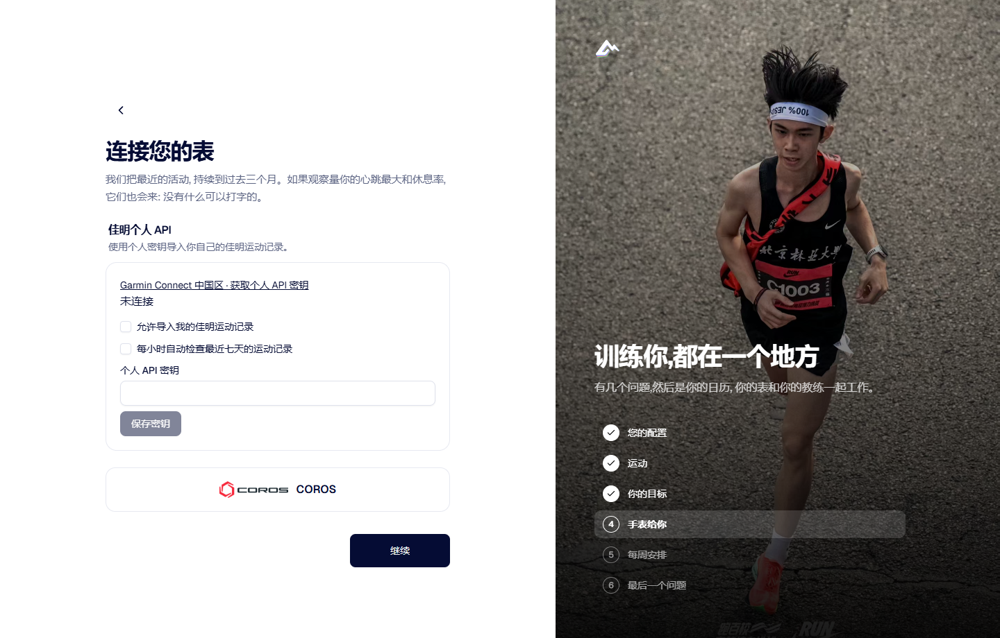

# 中长跑训练管理网页

Running Training Manager 是我基于 [OpenAthlete](https://github.com/openathleteorg/openathlete) 开源框架做的二次开发。项目源于我用佳明记录跑步的经历，希望把运动数据、训练计划、跑后感受和恢复记录放在一个网页里。它也是我的 IT 项目管理课程设计。

## 我拓展的功能

- **佳明中国区同步**。把个人 API 连接加到注册向导和设置页，支持按日期导入。处理上游分页失败、重试和重复识别，明确显示新增、已有和失败结果。
- **AI 教练与跑后复盘**。新增自由的多轮聊天及单独的跑后反馈。教练可追问训练或恢复情况，跑后反馈可匹配活动、保存自觉用力程度（RPE）并撤销。历史会话按账号保存在当前浏览器，侧栏与悬浮按钮打开同一个教练窗口。
- **模型选择**。支持 Ollama 运行的本机模型和 OpenRouter 的免费模型入口。模型调用遵循用户的数据处理授权。
- **私人伤病日志**。支持自己新增、修改和删除手动日志。手动记录根据访问权限保护，运动复盘不会自动读取它们。
- **简体中文与个性化**。新增简体中文，支持调整颜色和将照片加入主题。注册向导使用我的比赛照片。

训练日历、周期计划与活动详情沿用 OpenAthlete 的基础能力。系统面向电脑和手机浏览器。

## 运行与体验

- [本机部署与操作指南](docs/project/setup.md)
- [API 配置样例](docs/project/api.env.example)
- [合成 10 公里跑步记录](docs/project/demo-run-10k.tcx)，可通过设置中的文件导入试用。

本机验证过佳明连续导入和去重、Qwen3 中文复盘及多轮对话、RPE 保存和账号间的会话隔离。定向回归覆盖后端 34 项和前端 23 项。独立电脑的 Docker 部署、实际浏览器麦克风和真实云端模型推理仍需验收。

## 开源来源

主框架来自 OpenAthlete，上游源码基线为 [`7ba86f8`](https://github.com/openathleteorg/openathlete/commit/7ba86f85b1eebbc027d0da092b1f9a4ccee8b53c)。保留 [上游 README](README.upstream.md)、源代码归属和 [AGPL-3.0 许可证](LICENSE)。本仓库的代码按该许可证提供。比赛照片由我提供，用于本项目页面和展示。
